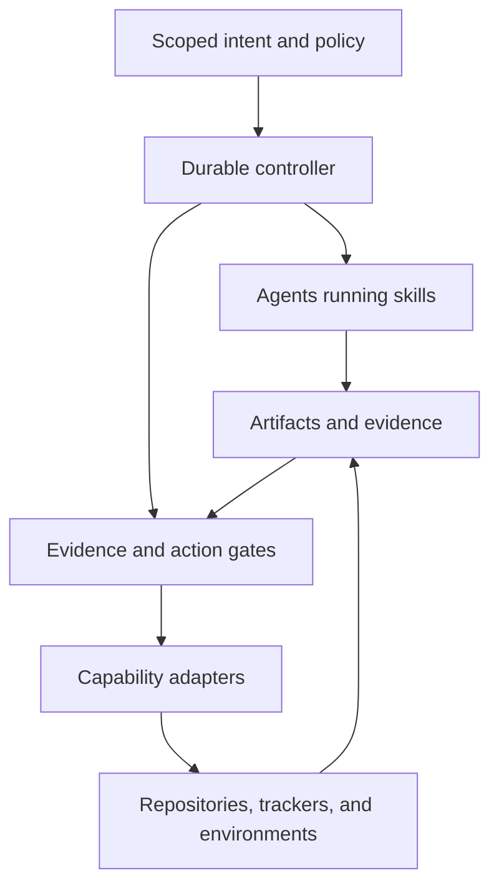

# Software factory architecture

A software factory repeatedly turns scoped intent into verified changes and
observed outcomes. Its useful unit is a controlled transition with evidence, not
an unrestricted agent session. sfstack supplies the work definitions and
interchange contracts from which that controller can be built.

## Responsibilities in the system

The controller selects work, resolves bindings, owns budgets and leases, and
records state transitions. Workers use the skills to perform bounded tasks.
Artifacts carry their results across agents and sessions. Gates evaluate whether
the evidence and authorization permit a proposed transition. Adapters enforce
that decision against the actual external resource.

The included planner and gate checker are offline reference implementations of
parts of this flow. They neither dispatch work nor form a security boundary.

## Durable state makes autonomy recoverable

An agent process can stop at any point. A tool can perform a write and lose its
response. Two workers can receive the same event. A controller that assumes every
call happens exactly once will eventually duplicate work or lose ownership.

Use durable run state, operation identities, leases, and conditional updates.
Record intent before an external operation and reconcile its observed result
afterward. On restart, inspect what actually happened before retrying. Preserve
existing authorship, decisions, and outstanding findings when another worker takes
over a task.

These responsibilities cannot be implemented solely by adding stronger wording
to a skill. They need storage and runtime enforcement appropriate to the host.

## Quality gates need a precise subject

A release decision must refer to the integrated candidate, not an earlier branch
that happened to pass. Merging or rebasing can change the subject. Deployment
verification must establish both the target environment and the revision serving
it. Evidence about another candidate cannot simply be carried across the gate.

The reference examples use fixed checkpoints to make this behavior inspectable.
A production controller may revalidate only affected checks if it has a reliable
dependency model. It must preserve the evidence and rationale for that decision.

## Autonomy is a scoped operating mode

A user may authorize a complete review workflow while reserving integration or
deployment. Another task may explicitly authorize a bounded release. The factory
should preserve both choices without repeatedly asking for already-granted
permission or treating one grant as authority for every later operation.

Capability availability, permission, evidence, and resource ownership are
separate conditions. A worker can have a deployment tool available and still lack
a valid release decision. A fully reviewed change can still be blocked by a
conflicting deployment in progress.

Policies should make high-impact boundaries explicit, including data operations,
external communication, integration, release publication, and deployment. A
failed guard must leave a reviewable record and a concrete next action.

## Start with a thin vertical slice

A practical first controller can use one agent, one project, local artifact
storage, one tracker adapter, and a feature-to-review workflow. Qualify that loop
before adding parallel writers, automatic integration, or production deployment.
Expand when a measured bottleneck or risk justifies the new responsibility.

The library covers the lifecycle, but a factory should activate only the
capabilities needed for each task. Human judgment remains useful for uncertain
product value, consequential tradeoffs, and approvals outside delegated scope.
The contracts make those decisions visible so they can be assigned and improved,
rather than hidden inside a long conversation.
