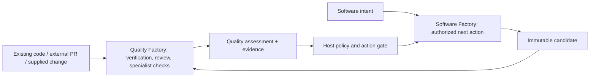

# Two operating modes, one evidence and policy system

sfstack supports **Software Factory** and **Quality Factory** as separate
entry points over the same versioned skills, artifact envelope, capability
adapters, execution protocol, and authorization gates.

| | Software Factory | Quality Factory |
| --- | --- | --- |
| Objective | Turn intent into scoped changes and verified delivery | Assess a fixed existing candidate, including code not built by sfstack |
| Starts with | Discovery, defect, feature, refactor, release or other recipe | [Quality workflow](../../workflows/quality.json) with a `request` |
| May modify code? | Under explicit scoped grants and host enforcement | **No**; quality workflows reject declared mutation capabilities and effects |
| Results | Plans, change sets, reports, review packages, deployments | A consolidated `quality-assessment`, with source reports and findings |
| Required runtime | Appropriate controller and environment adapters | Read-only source/PR access, isolated verification runner, evidence store |

**The dependency is one-way:** software delivery can consume quality reports.
Quality never requires `sf-build-change`, `sf-prepare-review`, integration,
deployment, or the original software factory to produce a candidate.

The library's existing `sf-verify-change`, `sf-review-change`,
`sf-assess-impact`, `sf-assess-security`, `sf-check-compatibility`, and
other specialist skills remain the only authorities for their respective
responsibilities. Two narrow bridge skills are new:
`sf-scope-candidate` (normalize a fixed external candidate into a
read-only `change-set`) and `sf-consolidate-quality` (report a consolidated
verdict). No second policy model, adapter framework, or evidence envelope exists.

A negative quality report must remain **consumable for reporting** but must
not become **passing evidence for a mutation**. The quality workflow can
explicitly accept named non-passing predecessor statuses when making a
read-only report. The software workflow has its original pass-only readiness
semantics, and action gates still require passing, current proof and exact
authorizations. An assessment marked `complete` in the planner means a
report was produced, **not** that the code passed.

Quality assessment is observational, not remediation. Source access must be
immutable or isolated; test execution can create temporary state, so the host
must enforce sandboxing and disposable fixtures. A quality recipe cannot itself
authorize a production read/write effect through a tool merely by declaring it.
The offline reference tools are **not** authentication or sandbox boundaries.

Independent review needs actual host-supplied identities and provenance;
different prompts or agent roles do not establish independence. The offline
consolidator retains reviewer metadata but cannot authenticate it, and reports
`inconclusive` when the policy requires independent review without a trusted
attestation. This is a limitation, not a waiver.

See [run quality](../how-to/run-quality.md), [workflow reference](../reference/workflows.md),
and [artifact semantics](../reference/artifacts.md).
